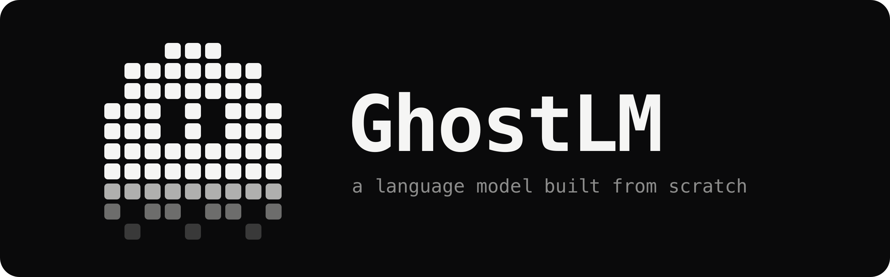
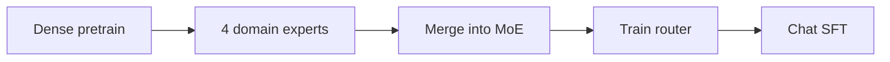

<p align="center">
 
</p>

<p align="center">
 
 
 
 
</p>

# GhostLM

A decoder-only language model written and trained from scratch: tokenizer, attention, optimizer, training loop, evaluation and serving. No pretrained weights and no `AutoModel.from_pretrained`. It is a small generalist (general knowledge, code, math) whose deepest domain is cybersecurity.

The repository is the whole system, not only the model: a multi-domain corpus pipeline, PyTorch and MLX trainers, a statistical eval suite, a tool-using agent runtime, retrieval, and four ways to serve it.

## Status

As of 2026-10-12.

| | |
|---|---|
| **Published model** | [`ghost-small-gen`](https://huggingface.co/Ghostgim/ghost-small-gen), 45M parameters, on Hugging Face |
| **In training** | `ghost-base`, 349M parameters, step 4,373 of 15,000, validation loss 2.76 |
| **Hardware** | One 16 GB Mac mini M4, training in the background with MLX |
| **Next** | Four domain experts, merged into a mixture-of-experts model, then chat tuning. All automated |
| **Tests** | 648, run on Python 3.10 and 3.13 in CI |

## What is in the box

- **Model.** Pre-norm transformer with RoPE, SwiGLU, RMSNorm, grouped-query attention, QK-norm, intra-document attention masking, a KV cache, and an optional mixture-of-experts feed-forward. Every layer is hand-written in [`ghostlm/model.py`](ghostlm/model.py).
- **Two training backends.** PyTorch (CUDA, MPS, multi-GPU DDP) and an MLX port that is about twice as fast on Apple Silicon. Both read the same checkpoints.
- **Optimizers.** AdamW, Muon and NorMuon, with cosine or warmup-stable-decay schedules and a multi-stage domain curriculum.
- **Unattended training.** A supervisor that trains whenever the machine is idle, pauses for memory pressure, resumes from its own checkpoints, evaluates on a schedule and backs up to Hugging Face.
- **Corpus pipeline.** Collectors for 27 sources, near-duplicate removal, benchmark decontamination, and a leakage-proof train/val split.
- **Evaluation.** GhostBench: debiased multi-permutation scoring with bootstrap confidence intervals and paired significance tests.
- **Agent runtime.** A tool-calling loop over any checkpoint, with nine security tools and cite-tagged answers.
- **Retrieval.** A hybrid retriever: exact lookup for CVE, CWE, CAPEC and ATT&CK IDs, dense search for everything else.
- **Ghost Code.** A terminal coding agent with tools, permission modes and an animated token-ghost mascot.
- **Serving.** A chat web app, an HTTP API that speaks the OpenAI, Anthropic, Gemini and Ollama wire formats, an MCP server, and a CLI.

## Quick start

```bash
git clone https://github.com/joemunene-by/GhostLM.git
cd GhostLM
make install
make test
```

Train the smallest model end to end on a CPU:

```bash
make data          # collect and build the corpus
make pretokenize   # optional: memory-mapped token files, instant startup
make train-tiny    # 14.7M parameters
make chat
```

Run the agent with no checkpoint and no network, to see the tool loop work:

```bash
python -m ghostlm.agent --query "What is CVE-2017-0144?" --offline
```

Run the chat app, which downloads `ghost-small-gen` on first use:

```bash
pip install -e '.[serve]'
python -m ghostlm.app --port 8091
```

`make help` lists every target.

## Models

| Model | Parameters | Shape | Status |
|---|---:|---|---|
| ghost-tiny | 14.7M | 2 layers, 256 wide | Reference implementation. Trains on a CPU |
| ghost-small-gen | 45M | 6 layers, 512 wide | Published. First generalist checkpoint |
| **ghost-base** | **349M** | **30 layers, 960 wide** | **In training** |
| ghost-1b | 2.1B total, 1.2B active | 24 layers, 1536 wide, 4 experts | Preset defined, untrained |
| ghost-3b | 6.0B total, 3.3B active | 32 layers, 2048 wide, 4 experts | Preset defined, untrained |

### ghost-base

| | |
|---|---|
| Layers, width | 30, d_model 960, d_ff 3936 (SwiGLU) |
| Attention | 15 query heads, 5 key/value heads (GQA), QK-norm, attention gate, value residual |
| Position, norm | RoPE, RMSNorm, pre-norm blocks |
| Context | 1,024 tokens |
| Tokenizer | GPT-2 BPE plus 7 special tokens |
| Optimizer | NorMuon with cautious weight decay, warmup-stable-decay schedule, peak LR 5e-4 |
| Batch | 65,536 tokens per step (64 sequences as 32 micro-batches) |
| Budget | 15,000 steps, about 1B tokens |

Design notes are in [docs/ARCHITECTURE.md](docs/ARCHITECTURE.md) and [docs/ghost_base_spec.md](docs/ghost_base_spec.md).

## Training pipeline



1. **Dense pretrain.** One 349M model on the full mixed corpus.
2. **Domain experts.** Four branches (cybersecurity, code, math, general) each continue from the last flat-learning-rate checkpoint on one domain.
3. **Merge.** The branches become the experts of a mixture-of-experts model ([`scripts/btx_merge.py`](scripts/btx_merge.py)).
4. **Router.** The routers, attention and norms train on mixed data with the experts frozen.
5. **Chat SFT.** The merged model is fine-tuned on conversation, tool use and cited answers.

The phase plan lives in [`scripts/background/phases.py`](scripts/background/phases.py). Each phase resumes from its own checkpoints, so the run survives pauses, crashes and reboots. Setup and operating notes are in [docs/mac_background_training.md](docs/mac_background_training.md).

Measured on the M4, ghost-base trains at about 775 tokens per second with MLX, against about 410 with PyTorch MPS. Peak trainer memory is 8.7 GB.

## Corpus

The ghost-base run trains on 396M tokens across six domains, after near-duplicate removal and benchmark decontamination.

| Domain | Tokens | Share |
|---|---:|---:|
| General web | 114.3M | 28.9% |
| Cybersecurity | 109.6M | 27.7% |
| Code | 78.4M | 19.8% |
| Math | 51.1M | 12.9% |
| Knowledge | 39.8M | 10.1% |
| Instruction | 2.3M | 0.6% |

Sources include FineWeb-Edu, Wikipedia, open-web-math, permissively licensed source code in 15 languages, NVD, MITRE ATT&CK, CAPEC, CWE, OWASP, Exploit-DB, NIST SP 800, security RFCs and CTF writeups. Per-source counts, licenses and reproduction commands are in [CORPUS.md](CORPUS.md).

## Results

All multiple-choice numbers use debiased text scoring: the log-probability of each option's text under several option orderings, so letter bias cannot help. Chance is 25%.

### ghost-small-gen (45M, published)

Full benchmark sets. Details and confidence intervals in [docs/scorecard.md](docs/scorecard.md).

| Benchmark | n | Accuracy |
|---|---:|---:|
| ARC-Easy | 2,365 | 27.2% |
| ARC-Challenge | 1,165 | 24.3% |
| OpenBookQA | 500 | 27.4% |
| SecQA | 210 | 34.3% |
| CTF eval | 30 | 63.3% |

### ghost-base (349M, in training)

Interim checks on 200-question samples (30 for CTF, 120 for math), so the intervals are wide. These are progress markers, not final results.

| Benchmark | Step 1,501 | Step 3,076 |
|---|---:|---:|
| SecQA | 43.5% | 58.5% |
| OpenBookQA | 31.8% | 35.8% |
| ARC-Challenge | 21.5% | 25.3% |
| ARC-Easy | 27.3% | 25.3% |
| CTF eval | 70.0% | 61.7% |
| Math | 25.8% | 17.5% |

### What the numbers mean

- Security knowledge is the clear signal. It is well above chance and still rising.
- General reasoning and math are at chance. At this size and token budget that is expected, and the math expert phase exists to address it.
- The run is about 1B tokens for a 349M model, several times less data than a model this size wants. Expect fluent, on-topic text with unreliable facts. This is why the chat app answers from retrieved sources and cites them.
- The earlier ghost-small line showed the same pattern: steady gains on multiple choice, near zero on free-form fact recall. That history, with every table, is in [docs/project_history.md](docs/project_history.md).

## Using a model

**Chat app.** A local web app with streaming, retrieval, citations and server-side chat history. See [docs/web_app.md](docs/web_app.md).

```bash
python -m ghostlm.app --port 8091
```

**HTTP API.** Any client built for OpenAI, Anthropic, Gemini or Ollama can point at it unchanged. Tool calls run server-side.

```bash
python -m ghostlm.agent.server --checkpoint <checkpoint.pt> --port 8000
```

**MCP server.** Exposes the model, the agent loop, and deterministic NVD and MITRE lookups to any MCP client. The checkpoint loads on first use. See [docs/mcp.md](docs/mcp.md).

```bash
claude mcp add ghostlm -- python3 scripts/mcp_server.py --checkpoint <checkpoint.pt>
```

**Agent CLI.** Tool-using loop with a JSON trace. Tools use their real upstream APIs when keys are set and fall back to an offline cache.

```bash
python -m ghostlm.agent --query "Explain T1059" --checkpoint <checkpoint.pt>
```

**Ghost Code.** A coding agent for the terminal, in the style of Claude Code: it reads, edits and runs code in the current folder with permission prompts. It works with any tool-capable model behind an OpenAI-compatible endpoint. See [docs/ghost_code.md](docs/ghost_code.md).

```bash
pip install -e '.[code]'
ghost
```

**Export.** Pickle-free safetensors with a SHA-256 and config.

```bash
python scripts/export.py --format safetensors
```

## Repository layout

```
ghostlm/            Core library
  model.py          Transformer, attention variants, MoE
  mlx_model.py      MLX port of the decoder
  trainer.py        PyTorch training loop
  muon.py           Muon and NorMuon optimizers
  curriculum.py     Multi-stage domain curriculum
  rag.py            Hybrid retriever
  identity.py       Single source for the assistant's persona
  agent/            Tool-using runtime, HTTP server, teacher client
  app/              Chat web app
  code/             Ghost Code, the terminal coding agent
ghostbench/         Evaluation suite
scripts/            Training, data, eval and export CLIs
  background/       Supervisor, phase plan, dashboard
data/               Collectors, corpus manifests, tokenizers
tests/              648 tests
docs/               Design notes, runbooks, findings
```

## Documentation

| Topic | Where |
|---|---|
| Architecture | [docs/ARCHITECTURE.md](docs/ARCHITECTURE.md) |
| ghost-base spec | [docs/ghost_base_spec.md](docs/ghost_base_spec.md) |
| Training on a Mac in the background | [docs/mac_background_training.md](docs/mac_background_training.md) |
| Training on a rented GPU | [docs/ghost_base_gpu_runbook.md](docs/ghost_base_gpu_runbook.md) |
| Corpus | [CORPUS.md](CORPUS.md), [docs/dataset.md](docs/dataset.md) |
| Evaluation and scorecard | [docs/scorecard.md](docs/scorecard.md), [docs/capability_atlas.md](docs/capability_atlas.md), [RESULTS.md](RESULTS.md) |
| Chat tuning and teacher data | [docs/chat_tuning.md](docs/chat_tuning.md), [docs/teacher_sft.md](docs/teacher_sft.md) |
| Retrieval | [docs/rag.md](docs/rag.md) |
| Web app, MCP | [docs/web_app.md](docs/web_app.md), [docs/mcp.md](docs/mcp.md) |
| Ghost Code | [docs/ghost_code.md](docs/ghost_code.md) |
| Model card | [MODEL_CARD.md](MODEL_CARD.md) |
| History, changelog | [docs/project_history.md](docs/project_history.md), [CHANGELOG.md](CHANGELOG.md) |

## Roadmap

1. Finish the ghost-base pipeline on the Mac: pretrain, experts, merge, router, chat tuning.
2. Retrain ghost-base on a GPU with the full token budget. This is the largest single quality gain available.
3. Long context (16K) through a RoPE rebase and a long-form fine-tune.
4. ghost-1b, trained as a mixture-of-experts from the first step.

Milestones, compute estimates and corpus targets are in [ROADMAP.md](ROADMAP.md).

## Why from scratch

Two reasons. A model trained with security text in its tokenizer and weights from the start treats CVE IDs, shell one-liners and technique names as ordinary vocabulary, where a fine-tune of an aligned model has to work against its prior. And the project is a study in how these systems are built: every component is readable in this repository, with nothing hidden behind a library call.

GhostLM is not competing with large models. It aims to be a small, transparent generalist with real security depth, measured with care and described accurately.

## Related

[`ghostloop`](https://github.com/joemunene-by/ghostloop) applies the same agent runtime, fail-closed safety gates and paired-comparison evaluation to robot motion primitives.

## Contributing

See [CONTRIBUTING.md](CONTRIBUTING.md).

## License

MIT. See [LICENSE](LICENSE).

## Author

**Joe Munene**, [Complex Developers](https://github.com/joemunene-by). Built in Nairobi, Kenya.
