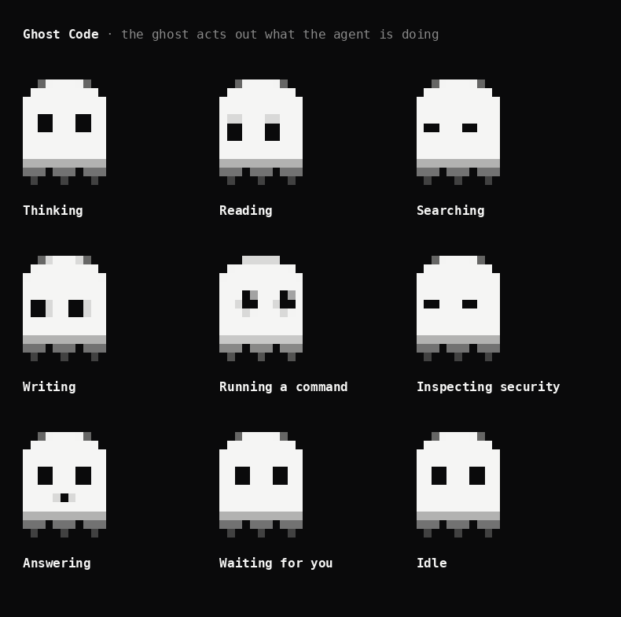

# Ghost Code

A terminal agent for securing your machine and your code. It audits the computer it
runs on, scans projects for leaked secrets and risky code, and reads, edits and runs
things in the folder you start it in, asking before it changes anything.

It talks to any OpenAI-compatible endpoint, so the model can be a local one served
by Ollama, the GhostLM agent server, vLLM, or a hosted API. With a local model,
nothing about your machine leaves it.


```bash
pip install -e '.[code]'
ghost                         # interactive, in the current folder
ghost "is anything on this machine listening on the network?"
ghost -p "summarise this repo" # answer and exit
ghost -c                      # resume the last session in this folder
```

## Choosing a model

By default `ghost` connects to Ollama at `http://localhost:11434/v1` and picks an
installed model, preferring one with "coder" in its name.

| Setting | Flag | Environment | `~/.ghostcode/config.json` |
|---|---|---|---|
| Endpoint | `--base-url` | `GHOST_BASE_URL` | `base_url` |
| Model | `--model` | `GHOST_MODEL` | `model` |
| API key | | `GHOST_API_KEY` | `api_key` |

The model must support tool calling. To use a GhostLM checkpoint, serve it with
`python -m ghostlm.agent.server --checkpoint <checkpoint.pt> --port 8000` and pass
`--base-url http://localhost:8000/v1`. The small GhostLM checkpoints are not yet
strong enough to drive an agent loop; a tool-capable model of 7B parameters or more
is a realistic floor.

Ollama's OpenAI endpoint cannot set the context length and silently truncates at
4,096 tokens, so when the endpoint is Ollama, `ghost` uses its native API and asks for
16,384. Change that with `GHOST_CONTEXT` or `"context"` in the config file. A larger
context uses more memory.

## Security

| Command | What it does |
|---|---|
| `/audit` | Read-only audit of this machine, reported worst first with the fix for each finding |
| `/scan` | Scan the current folder for secrets, injection, disabled TLS checks and old pinned dependencies |

You can also just ask: "why is port 5000 open?", "which startup items look unusual?",
"is CVE-2024-3094 being exploited?".

The audit collects evidence with fixed, read-only commands, so it never prompts and
never changes anything. Applying a fix is a separate step that asks first.

| Area | macOS | Linux |
|---|---|---|
| `firewall` | Application firewall state, stealth mode | ufw or firewalld |
| `disk_encryption` | FileVault | LUKS volumes |
| `system_protection` | SIP, Gatekeeper, guest account | ASLR, AppArmor or SELinux |
| `listening_ports` | Processes listening on TCP | The same, with `ss` |
| `remote_access` | SSH, screen sharing, file sharing, sshd settings | sshd state and settings |
| `persistence` | Launch agents and daemons, crontab | Enabled services, cron |
| `accounts` | Local users, admin group | Users with a login, sudo group |
| `ssh_keys` | `~/.ssh` contents and permissions, authorized keys | The same |
| `updates` | OS version, automatic update settings | Pending package updates |

The secret scanner looks for private keys, AWS, GitHub, Slack and `sk-` style keys,
credentials in URLs, and hardcoded passwords or tokens. It reports the file and line
with the value masked, so secrets are not sent to the model.

`lookup_cve` queries NVD and CISA's Known Exploited Vulnerabilities list, falling
back to a small offline cache without a network.

Ghost Code works defensively, on systems you own or are authorised to test.

## Interface

The input box stays at the bottom of the window the whole time. While the agent
works you can keep typing: a message sent mid-turn is queued and runs next.

There is one ghost, and it lives in the free space above the box. While the agent
works it docks beside the status line and acts out the work: looking around while
it thinks, scanning while it reads, squinting while it searches, bobbing while it
writes, running while a shell command runs, talking while it answers, and watching
you while it waits for a permission answer. When there is nothing to do it drifts
across the empty space, looks around, and settles in the corner for a nap.



The animation runs at 60 frames a second, which costs about a third of one CPU core while
`ghost` is open. Set `GHOST_FPS=30` (or `"fps": 30` in the config file) to roughly halve that.

Permission questions only take keys while the input is empty, so typing a message
never answers one by accident.

| Key | Action |
|---|---|
| `enter` | Send |
| `\` then `enter`, or `esc` then `enter` | New line |
| `shift+tab` | Cycle permission mode |
| `esc` | Interrupt the model or a running shell command |
| `! command` | Run a shell command yourself; the output joins the conversation |
| `@ path` | Complete a file path |
| `ctrl+c` twice | Quit |

| Command | |
|---|---|
| `/help` | Commands and shortcuts |
| `/clear` | Start a fresh conversation |
| `/compact` | Replace the conversation with a summary to free context |
| `/model [name]` | Show or switch the model |
| `/mode [name]` | Show or set the permission mode |
| `/status` | Model, endpoint, mode, context size |
| `/audit` | Security audit of this machine |
| `/scan` | Security scan of this folder |
| `/init` | Have the agent write a `GHOST.md` for the project |
| `/exit` | Quit |

## Permissions

Reading, searching and the security checks never ask. Everything else depends on the mode.

| Mode | Edits in the working folder | Edits elsewhere | Shell commands |
|---|---|---|---|
| default | Ask | Ask | Ask |
| accept edits | Allowed | Ask | Ask |
| plan | Refused | Refused | Refused |

Each prompt offers "yes", "yes for this session" and "no". Session approval for a
shell command covers its first two words, so approving `git status` also covers
`git status --short` but not `git push`. `--allow-all` skips every prompt and is
meant for throwaway sandboxes.

With `--print` there is nobody to ask, so anything that would prompt is refused
unless `--mode "accept edits"` or `--allow-all` permits it.

## Project instructions

If the working folder has a `GHOST.md` (or `AGENTS.md`, or `CLAUDE.md`), its
contents are added to the system prompt.

## Tools

`read_file`, `write_file`, `edit_file`, `bash`, `grep`, `glob`, `list_dir`,
`security_check`, `secret_scan`, `lookup_cve`. Search
skips `.git`, `node_modules`, virtual environments and build folders. Tool output
over 20,000 characters is truncated.

## Files

State lives in `~/.ghostcode/` (override with `GHOST_HOME`): `config.json`, prompt
`history`, and one saved session per working folder under `sessions/`.

## Layout

| File | |
|---|---|
| `ghostlm/code/cli.py` | Prompt, slash commands, `--print` mode |
| `ghostlm/code/agent.py` | The loop, permission modes, system prompt |
| `ghostlm/code/tools.py` | Tool definitions and handlers |
| `ghostlm/code/backend.py` | Streaming chat client |
| `ghostlm/code/ui.py` | Transcript, status line, permission prompt |
| `ghostlm/code/mascot.py` | The animated token ghost |
